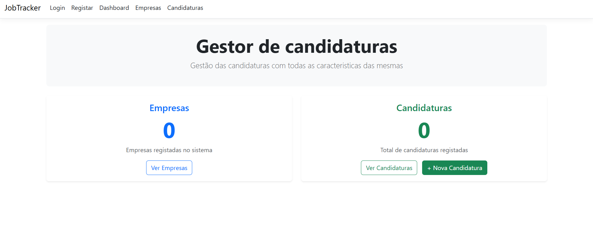
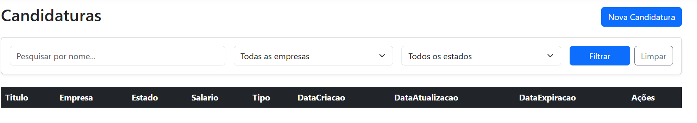

# CRM - Gestor de Candidaturas (JobTracker)

Um manager para propostas de currículos para uso pessoal. Controla o estado de cada candidatura com filtros de paginação.

## ✨ Funcionalidades Principais
- **Dashboard:** Visão geral com métricas de total de empresas e candidaturas.
- **Autenticação Segura:** Registo e Login de utilizadores via ASP.NET Core Identity.
- **Gestão de Empresas:** CRUD completo para gerir as empresas alvo (Nome, Localização, Stack Tecnológica).
- **Gestão de Candidaturas:** Tracking detalhado de vagas (Salário, Requisitos, Datas de Expiração e Estados como "Submetido", "Teste Técnico", "Oferta Aberta").
- **Pesquisa e Filtros:** Filtragem avançada de candidaturas por nome, empresa e estado atual.

## 🛠️ Stack Tecnológica
- **Backend:** C# / .NET 10.0 (ASP.NET Core MVC)
- **Base de Dados:** PostgreSQL
- **ORM:** Entity Framework Core
- **Autenticação:** ASP.NET Core Identity

## 📋 Pré-requisitos
- [.NET 10.0 SDK](https://dotnet.microsoft.com/download/dotnet/10.0)
- [PostgreSQL](https://www.postgresql.org/download/) a correr localmente ou via Docker

## ⚙️ Instalação e Configuração

1.   Clona este repositório:
   ```bash
   git clone https://github.com/Telmo47/CRM.git
   ```

2. Navega para a pasta do projeto:
    ```bash
    cd CRM
    ```

3. Inicializa os User Secrets para protegeres a tua password local:
    ```bash
    dotnet user-secrets init
    dotnet user-secrets set "ConnectionStrings:DefaultConnection" "Host=localhost;Port=5432;Database=jobtracker_db;Username=postgres;Password=A_TUA_PASSWORD_REAL"
    ```

## 🐳 Configuração da Base de Dados (Docker)
Se tiveres o Docker instalado, levanta rapidamente uma instância de PostgreSQL:
    ```bash
    docker run --name postgres-crm -e POSTGRES_PASSWORD=A_TUA_PASSWORD_REAL -p 5432:5432 -d postgres
    ```

## 🚀 Correr a Aplicação
Para aplicares as migrações e correres o projeto:
    ```bash
    dotnet ef database update
    dotnet run
    ```

Acede à aplicação no teu browser através de https://localhost:7235.


## 📸 Screenshots

### Dashboard


### Lista de Candidaturas
